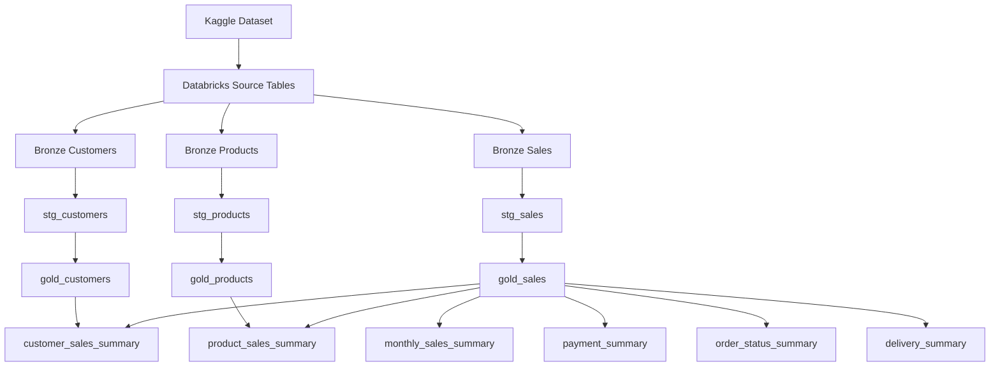

# Indian E-Commerce Sales Analytics | End-to-End Data Engineering Project

\

## Project Overview

An end-to-end data engineering project that transforms Indian e-commerce sales data into clean, structured and analytics-ready datasets using **Databricks, dbt Core, SQL and Unity Catalog**.

The project implements the **Medallion Architecture (Bronze, Silver and Gold)** to organize data ingestion, cleaning, standardization, transformation and analytical modelling.

The primary objective is to build a reliable data transformation pipeline with data quality checks and business-oriented analytical datasets.

## Architecture

This project follows the Medallion Architecture.

```text
                   Kaggle Dataset
                         |
                         v
              Databricks Source Tables
                         |
                         v
                  BRONZE LAYER
                  Raw Data Tables
                         |
                         v
                  SILVER LAYER
             Cleaning & Standardization
                         |
                         v
                   GOLD LAYER
              Analytics-Ready Tables
                         |
               +---------+---------+
               |                   |
               v                   v
           Base Tables       Analytics Tables
```

## Data Lineage

The following diagram illustrates the transformation flow and model dependencies in the project.



_Note: This is the documented architecture and intended dependency flow. The actual dbt lineage graph is available through dbt documentation._

## Technology Stack

| Technology              | Purpose                                       |
| ----------------------- | --------------------------------------------- |
| Databricks Free Edition | Data platform and processing                  |
| Unity Catalog           | Data organization and governance              |
| dbt Core                | Data transformation and testing               |
| SQL                     | Data cleaning, transformation and aggregation |
| Python                  | Development environment and project setup     |
| Git & GitHub            | Version control and project management        |

## Dataset Information

**Dataset:** Indian E-Commerce Sales Analytics
**Source:** Kaggle

The project uses three datasets:

| Dataset   |     Records | Description                   |
| --------- | ----------: | ----------------------------- |
| Customers |      40,000 | Customer information          |
| Products  |       2,000 | Product information           |
| Sales     |     250,000 | E-commerce order transactions |
| **Total** | **292,000** |                               |

### Dataset Characteristics

- 40,000 customers
- 2,000 product records
- 250,000 sales transactions
- 7 product categories
- 4 payment methods
- 5 order statuses

## Data Pipeline Implementation

### 1. Bronze Layer – Raw Data Ingestion

The Bronze layer stores the original source data in Databricks.

**Tables:**

- customers
- products
- sales

Activities:

- Loaded raw datasets into Databricks.
- Created Bronze tables using dbt.
- Preserved source-level data for downstream transformations.

### 2. Silver Layer – Data Cleaning and Transformation

The Silver layer prepares the raw data for analytical use.

**Models:**

- stg_customers
- stg_products
- stg_sales

Transformations performed:

**Customer Data**

- Trimmed whitespace.
- Standardized gender values.
- Standardized state names.
- Converted appropriate data types.
- Selected analytics-relevant attributes.

**Product Data**

- Standardized category values.
- Converted financial columns into decimal types.
- Converted numerical attributes into appropriate data types.
- Retained product pricing and discount information.

**Sales Data**

- Standardized payment methods and order statuses.
- Converted financial columns into decimal types.
- Preserved NULL values for optional coupon and review fields.
- Calculated delivery duration.
- Added financial validation flags.
- Checked order-level financial calculations.

### 3. Gold Layer – Analytics-Ready Data

The Gold layer contains three base models and six analytical summary models.

**Base Models**

| Model          | Description                     |
| -------------- | ------------------------------- |
| gold_customers | Clean customer dataset          |
| gold_products  | Clean product dataset           |
| gold_sales     | Clean sales transaction dataset |

**Analytical Models**

| Model                  | Description                                       |
| ---------------------- | ------------------------------------------------- |
| monthly_sales_summary  | Monthly order and delivered sales performance     |
| customer_sales_summary | Customer-level order and delivered sales analysis |
| product_sales_summary  | Product-level order and sales analysis            |
| payment_summary        | Payment method performance                        |
| order_status_summary   | Order status distribution and metrics             |
| delivery_summary       | City and state-level delivery performance         |

## Data Quality and Testing

Data quality validation is implemented using dbt generic tests and singular SQL tests.

### Generic Tests – schema.yml

Implemented tests:

- Unique constraints
- Not-null constraints
- Referential integrity
- Accepted values

### Singular Tests – tests/

Custom SQL tests implemented:

1. **Sales Amount Reconciliation**

   Validates the financial formula:

   `Total Amount = Order Value + Shipping Cost - Coupon Discount`

2. **Delivery Date Validation**

   Checks that delivery dates are not earlier than order dates.

3. **Delivered Orders Must Have a Delivery Date**

   Checks that every delivered order has a recorded delivery date.

### Data Quality Findings

During data profiling and validation:

- Identified 5 records with negative total amounts.
- Identified 107 records where coupon discounts exceeded order values.
- Verified order-level financial calculations.
- Verified customer and product referential integrity.
- Checked primary key uniqueness.
- Preserved anomalous records and created validation flags instead of automatically deleting them.

## dbt Project Structure

```text
sales_analytics_project/
│
├── models/
│   │
│   ├── bronze/
│   │
│   ├── silver/
│   │
│   ├── gold/
│       ├── gold_customers.sql
│       ├── gold_products.sql
│       ├── gold_sales.sql
│       │
│       └── analytics/
│           ├── monthly_sales_summary.sql
│           ├── customer_sales_summary.sql
│           ├── product_sales_summary.sql
│           ├── payment_summary.sql
│           ├── order_status_summary.sql
│           └── delivery_summary.sql
│
├── tests/
│   ├── assert_sales_amount_is_valid.sql
│   ├── assert_delivery_date_is_valid.sql
│   └── assert_delivered_orders_have_delivery_date.sql
│
├── macros/
├── dbt_project.yml
├── packages.yml
└── .gitignore
```

## Running the Project

Run the following commands from the dbt project root directory.

**1. Verify Databricks connection**

```bash
dbt debug
```

**2. Run all dbt models**

```bash
dbt run
```

**3. Execute all data quality tests**

```bash
dbt test
```

**4. Run a specific model**

```bash
dbt run --select gold_sales
```

**5. Generate dbt documentation**

```bash
dbt docs generate
```

**6. Launch dbt documentation**

```bash
dbt docs serve
```

## Key Learning Outcomes

Through this project, I gained practical experience in:

- Implementing Medallion Architecture.
- Working with Databricks and Unity Catalog.
- Building SQL transformations using dbt Core.
- Understanding dbt models, sources, refs and dependencies.
- Implementing generic and singular data quality tests.
- Performing data profiling and financial data validation.
- Building analytics-ready datasets.
- Generating dbt documentation and exploring data lineage.

## Future Enhancements

- Implement incremental models for efficient data processing.
- Implement dbt snapshots for historical data tracking.
- Introduce Apache Airflow for workflow orchestration.
- Integrate Power BI for business intelligence and reporting.

## Author

**Syed Althaf**
